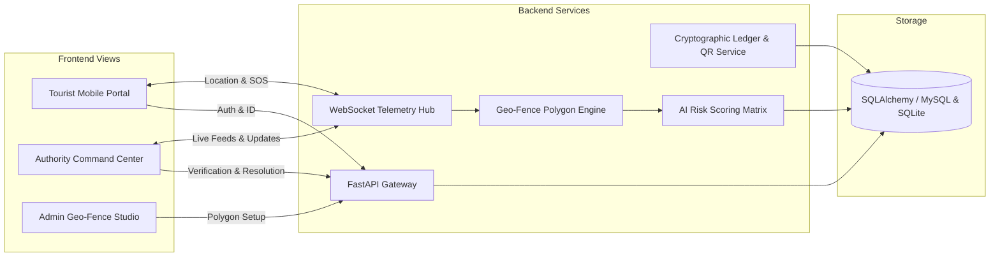

# 📋 Implementation Plan: Smart Tourist Safety Monitoring & Incident Response System

## 🎯 Project Overview
The objective is to implement a production-grade, demo-ready web application for the **Smart Tourist Safety Monitoring and Incident Response System**. The solution provides real-time GPS tracking, automated geo-fence breach detection, AI-driven risk scoring, blockchain-anchored digital identity with QR verification, and instant one-touch SOS incident reporting.

---

## 🏗️ Architectural Blueprint



---

## 🛠️ Technology Stack Breakdown

| Layer | Selected Tech | Rationale |
| :--- | :--- | :--- |
| **Backend Framework** | **Python 3.14 + FastAPI** | Native asynchronous capabilities, high throughput, built-in WebSocket support, and rapid auto-generated OpenAPI documentation. |
| **Database** | **SQLAlchemy ORM + SQLite / MySQL 8.0** | Out-of-the-box zero-setup execution with SQLite, with full MySQL 8.0 connection string configuration support for production. |
| **Realtime Telemetry** | **FastAPI WebSockets** | Sub-second latency for live GPS coordinate updates and instantaneous emergency SOS broadcasts. |
| **Geo-Fencing** | **Custom Ray-Casting Algorithm** | Mathematical point-in-polygon computation without external heavy C-libraries; highly reliable across all environments. |
| **AI / Risk Classifier** | **Multi-Factor Risk Engine** | Heuristic & algorithmic scoring combining zone threat level, temporal metrics (day/night), incident nature, and historical vulnerability. |
| **Blockchain & Identity** | **SHA-256 Merkle Ledger + `qrcode`** | Tamper-evident cryptographic transaction hashes, digital tourist certificates, and printable/scannable QR tokens. |
| **Frontend & UI** | **Vanilla HTML5, Modern CSS & ES6 JS** | Ultra-responsive, zero compilation overhead, glassmorphic dark-theme aesthetics for Authority Command Center and clean mobile UX for Tourists. |
| **Mapping Engine** | **Leaflet.js + OpenStreetMap** | Smooth vector maps, custom animated radar pulses, polygon rendering, and zero API-key lockouts (Google Maps API ready). |

---

## 📅 Step-by-Step Implementation Phases

### 🔹 Phase 1: Environment & Project Scaffolding
- Setup project directory structure:
  ```text
  d:\Project\
  ├── app/
  │   ├── core/           # Config, database, security
  │   ├── models/         # SQLAlchemy ORM models
  │   ├── schemas/        # Pydantic validation schemas
  │   ├── services/       # Geo-fence, AI, Blockchain, WebSocket manager
  │   ├── routers/        # API endpoints (tourists, incidents, zones, auth)
  │   └── static/         # CSS, JS, audio assets, images
  │       ├── css/
  │       ├── js/
  │       └── templates/  # HTML views (Tourist, Authority, Admin)
  ├── requirements.txt
  ├── run.py
  ├── README.md
  └── IMPLEMENTATION_PLAN.md
  ```
- Install dependencies: `fastapi`, `uvicorn[standard]`, `sqlalchemy`, `pydantic`, `qrcode`, `pillow`, `jinja2`, `python-multipart`.

---

### 🔹 Phase 2: Database Models & Schemas
- Define core SQLAlchemy entities:
  - **`Tourist`**: `id`, `name`, `contact`, `email`, `digital_id`, `blockchain_hash`, `qr_code_path`, `is_active`, `created_at`
  - **`LocationLog`**: `id`, `tourist_id`, `latitude`, `longitude`, `speed`, `accuracy`, `timestamp`
  - **`Zone`**: `id`, `name`, `type` (`SAFE`, `RESTRICTED`, `HIGH_RISK`), `boundary_geojson`, `color_code`, `description`
  - **`Incident`**: `id`, `tourist_id`, `type` (`SOS`, `GEOFENCE_BREACH`), `latitude`, `longitude`, `risk_level`, `risk_score`, `status` (`OPEN`, `ACKNOWLEDGED`, `RESOLVED`), `details`, `timestamp`
  - **`Authority`**: `id`, `username`, `full_name`, `badge_number`, `role`

---

### 🔹 Phase 3: Blockchain Identity & QR Code Engine
- Create cryptographic block generation:
  - Format: `SHA256(TouristID + Name + Contact + SecretSalt + Timestamp)`
  - Simulate blockchain transaction block with block height, transaction hash, and timestamp.
- Embed Digital Tourist ID and verification URL into dynamic QR codes using `qrcode` & PIL.
- Build public verification endpoint `/api/v1/verify/{digital_id}` returning verified cryptographic identity proof.

---

### 🔹 Phase 4: Geo-Fencing & AI Risk Engine
- **Geo-Fencing Engine:**
  - Implement point-in-polygon ray-casting algorithm to test whether a given `(lat, lon)` is inside defined zone boundaries.
  - Test against multiple zones ordered by danger level.
- **AI Risk Classifier:**
  - Scoring factors:
    - Base trigger weight: SOS = 70 pts, High-Risk Zone breach = 60 pts, Restricted breach = 40 pts.
    - Time of day factor: 21:00 to 05:00 adds +20 risk pts.
    - Repeated alerts in 15 mins adds +15 risk pts.
  - Risk thresholds:
    - `0 - 39`: **LOW** (Informational alert)
    - `40 - 69`: **MEDIUM** (Caution / Monitoring required)
    - `70 - 100`: **HIGH** (Immediate tactical dispatch required)

---

### 🔹 Phase 5: WebSocket Real-Time Telemetry & Alert Dispatch
- Build `WebSocketManager` supporting multi-channel broadcasts:
  - Channel `tourist:{id}` for individual status and warnings.
  - Channel `authorities` for tactical broadcast to all active responder dashboards.
- Handle instant event broadcasting on SOS press and geo-fence violations.

---

### 🔹 Phase 6: Tourist Safety Portal UI
- **Mobile-First Responsive Interface:**
  - Modern, clean layout with glassmorphic cards and intuitive touch targets.
  - **Live GPS Tracking Beacon Toggle:** Start/Stop location sharing with visual status indicator.
  - **One-Touch Emergency SOS:** High-visibility pulsing red SOS button with 3-second cancel safeguard to prevent accidental taps.
  - **Digital Tourist ID Card:** Digital pass with profile info, cryptographic badge, and dynamic QR code.
  - **Live Safety Status Banner:** Dynamic indicator (🟢 "You are in a Safe Zone" / 🔴 "Warning: Restricted Area Detected").

---

### 🔹 Phase 7: Authority Command Center Dashboard
- **Tactical Dark-Mode Command Center:**
  - **Live Tactical Map:** Leaflet map with dark tiles, real-time markers for active tourists, zone polygon overlays, and incident pulse rings.
  - **Incident Triage Queue:** Real-time table filterable by risk level (HIGH, MEDIUM, LOW) and status.
  - **Digital ID Inspector & Scanner:** Search and instant verification modal for checking tourist credentials.
  - **Incident Resolution Flow:** One-click "Acknowledge" and "Mark Resolved" with response log.
  - **Audio & Visual Alerts:** Audible emergency tone and visual toast notification when a HIGH risk incident triggers.

---

### 🔹 Phase 8: Admin Geo-Fence Studio
- Interactive map editor where administrators can:
  - Click to draw custom polygons or define circular zones.
  - Set zone type (`SAFE`, `RESTRICTED`, `HIGH_RISK`) and assign risk weights.
  - Save zone configurations directly to the database.

---

### 🔹 Phase 9: Demo Simulation Mode & Sample Data
- Built-in seeder script with pre-configured:
  - Tourist profiles (e.g., Alice, Bob, Charlie).
  - Geofence zones around a popular tourist spot (e.g., Central Park or Old City Heritage Zone).
  - One-click "Simulate Incident" and "Simulate Tourist Walk" button for instant demonstration without physical travel.

---

## 🚦 Verification Checklist

| Step | Test Case | Success Criteria |
| :---: | :--- | :--- |
| 1 | Tourist Registration | New tourist created with valid Digital ID, QR code, and blockchain hash. |
| 2 | GPS Telemetry | Browser updates location, rendered on both tourist and authority maps. |
| 3 | Geo-Fence Breach | Moving marker into Restricted Zone triggers alert on both portals < 1s. |
| 4 | AI Risk Scoring | Night-time SOS yields HIGH risk rating with breakdown explanation. |
| 5 | One-Touch SOS | Clicking SOS creates incident, updates authority dashboard via WebSocket instantly. |
| 6 | ID Verification | Looking up or scanning Tourist QR returns valid verified credential status. |
| 7 | Incident Resolution | Officer marks incident acknowledged/resolved; map and table update live. |
